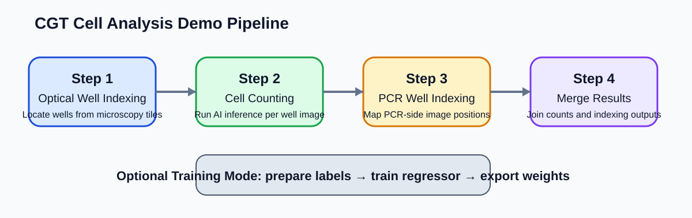

# CGT Cell Analysis Demo

> A desktop **and** headless pipeline for microscopy-based cell analysis — optical well indexing, AI cell counting, PCR well indexing, and result merging — built as a portfolio-grade reconstruction of a real computer-vision tool.

[](https://github.com/Jinwooseol/CGT-Cell-Analysis-Demo/actions/workflows/ci.yml)
[](https://www.python.org/)
[](LICENSE)
[](https://github.com/astral-sh/ruff)



This project demonstrates how a multi-stage AI/computer-vision workflow — the kind used in cell &
gene therapy (CGT) microscopy analysis — can be engineered as a maintainable application rather than
a pile of notebooks. The **same processing core** is exposed two ways: a **PySide6 desktop GUI** for
interactive use and a **headless CLI** for scripting, automation, and CI.

---

## Table of contents

- [Highlights](#highlights)
- [The pipeline](#the-pipeline)
- [Architecture](#architecture)
- [Quick start](#quick-start)
- [Command-line usage](#command-line-usage)
- [Configuration](#configuration)
- [Project structure](#project-structure)
- [Development](#development)
- [Packaging](#packaging)
- [Roadmap](#roadmap)
- [Scope & disclaimer](#scope--disclaimer)
- [License](#license)

---

## Highlights

- **Two front-ends, one core.** GUI and CLI drive the *identical* worker classes — no duplicated
  logic. The pipeline is therefore scriptable and testable, not GUI-locked.
- **Staged pipeline orchestration.** A `PipelineController` chains four background stages over a
  `QThreadPool`, streaming log/progress/done/error signals to whichever front-end is attached.
- **Non-blocking workers.** Each stage is a cancellable `QRunnable`, keeping the UI responsive during
  long image-processing and inference runs.
- **Real computer vision.** Contour/marker detection, PCA-based grid estimation, affine alignment,
  and KD-tree nearest-neighbour well matching (OpenCV + SciPy + scikit-learn).
- **Deep-learning inference.** EfficientNet-B4 regression head for per-well cell counting, with
  mixed-precision, batched, threaded image loading and graceful CPU/OOM fallback.
- **Typed configuration.** A single `AppConfig` dataclass with load/save/resolve/validate helpers.
- **Tested & linted.** A `pytest` suite covers the geometry, config, I/O, and an end-to-end worker
  run; `ruff` enforces style; GitHub Actions runs both across Python 3.10–3.12.

## The pipeline

| # | Stage | Module | What it does |
|---|-------|--------|--------------|
| 1 | **Optical Well Indexing** | `optical_well_indexing.py` | Detect wells in optical tile images, estimate the grid, and align each tile to the reference layout; crop per-well images. |
| 2 | **Cell Counting** | `cell_counting.py` | Run the EfficientNet regressor over the cropped well images to produce per-well cell-count scores. |
| 3 | **PCR Well Indexing** | `pcr_well_indexing.py` | Detect the 5×5 marker grid on PCR imagery, map well positions into the same logical layout, and label the raw G/R channel data. |
| 4 | **Merge Results** | `merge_cell_count_pcr.py` | Join cell-count results with the labeled PCR data into a final exported CSV per channel. |

Stages 1→2→4 chain automatically; stage 3 (PCR) feeds stage 4. See
[`docs/architecture.md`](docs/architecture.md) for the data-flow detail.

## Architecture

A controller-plus-worker design with clean layer separation:

| Layer | Package | Responsibility |
|-------|---------|----------------|
| **UI** | `ui/` | PySide6 windows, panels, file tree, preview, progress, and execution controls. |
| **CLI** | `cli.py` | Headless, display-free runner for the full pipeline or any single stage. |
| **Controller** | `core/pipeline_controller.py` | Triggers stages, manages state, and auto-chains steps via `QThreadPool`. |
| **Workers** | `core/workers/` | One cancellable `QRunnable` per stage; the actual processing. |
| **Config** | `config.py` | Typed `AppConfig`: defaults, JSON load/save, path resolution, validation. |
| **I/O** | `io/` | CSV helpers, including the instrument two-row-header format. |
| **Model** | `model/` | EfficientNet regressor definition and job data models. |
| **Util** | `util/` | Logging facilities shared by the GUI and CLI. |

```
UI  ─┐
     ├─►  PipelineController ──► Worker (QRunnable) ──► I/O · Model · Geometry
CLI ─┘            ▲                     │
                  └──── signals ────────┘   (log / progress / done / error)
```

## Quick start

Requires **Python 3.10+**.

```bash
# 1. Clone
git clone https://github.com/Jinwooseol/CGT-Cell-Analysis-Demo.git
cd CGT-Cell-Analysis-Demo

# 2. Create a virtual environment
python -m venv .venv
# Windows:  .venv\Scripts\activate
# Unix:     source .venv/bin/activate

# 3a. Full install (GUI + model inference)
pip install -r requirements.txt

#    …or use the extras defined in pyproject.toml:
pip install -e ".[ai]"        # core + model inference
pip install -e ".[dev]"       # + linting / testing tools
```

Then create your local config and launch:

```bash
cp config.example.json config.json        # Windows: copy config.example.json config.json
python app.py                             # or: cgt-demo   (after pip install -e .)
```

> **Model weights** are not shipped. Place your weights at `models/demo_model_weights.pth`
> (or point `ai_model_weights_path` in `config.json` elsewhere). Stages 1, 3, and 4 run without
> weights; only stage 2 (cell counting) needs them.

## Command-line usage

The headless runner needs no display and is ideal for batch jobs, servers, and CI:

```bash
# Validate config and that referenced resources exist
cgt-cli validate                  # add --require-model to also check weights
cgt-cli info                      # print the resolved configuration

# Run the full four-stage pipeline for one sample
cgt-cli run --sample S001 \
    --optical-tiles data/S001/optical \
    --pcr data/S001/pcr \
    --out-root work

# …or run a single stage
cgt-cli optical --tiles data/S001/optical --out work/S001/01_optical
cgt-cli count   --images work/S001/01_optical/Well_Image --out work/S001/02_count
```

Full command reference: [`docs/cli.md`](docs/cli.md).

## Configuration

Configuration is plain JSON (`config.json`, ignored by git; copy from `config.example.json`).
Relative paths resolve against the project root.

| Key | Type | Default | Description |
|-----|------|---------|-------------|
| `sensor_map` | path | `reference_data/ref_sensor_map_hd.tif` | Reference sensor map image. |
| `marker_7x7` / `marker_5x5` | path | `reference_data/...` | Reference marker grids (optical / PCR). |
| `well_csv` | path | `reference_data/ref_well_position.csv` | Reference well coordinates. |
| `ai_model_weights_path` | path | `models/demo_model_weights.pth` | Cell-counting model weights. |
| `batch_size` | int | `32` | Inference batch size. |
| `confidence_threshold` | float | `0.5` | Rounding threshold for fractional cell counts. |
| `image_size` | int | `224` | Model input size. |
| `use_gpu` | bool | `true` | Use CUDA when available. |
| `use_half_precision` | bool | `false` | FP16 inference on GPU. |
| `num_workers` | int | `4` | Image-loading threads. |
| `output_format` | str | `csv` | Output format. |

More detail: [`docs/configuration.md`](docs/configuration.md).

## Project structure

```text
CGT-Cell-Analysis-Demo/
├── app.py                       # GUI entry point
├── cgt_cell_analysis_demo/
│   ├── cli.py                   # headless pipeline runner
│   ├── config.py                # typed AppConfig
│   ├── core/
│   │   ├── pipeline_controller.py
│   │   └── workers/             # one worker per stage
│   ├── io/                      # CSV helpers
│   ├── model/                   # model architecture + job models
│   ├── ui/                      # PySide6 panels & widgets
│   └── util/                    # logging
├── reference_data/              # reference grids / maps (shipped)
├── models/                      # model weights (not shipped)
├── tests/                       # pytest suite
├── docs/                        # architecture, CLI, configuration, build
├── assets/                      # diagrams
└── scripts/                     # packaging / run helpers
```

## Development

```bash
pip install -e ".[dev]"
pre-commit install            # optional: run lint/format on every commit

ruff check cgt_cell_analysis_demo tests     # lint
ruff format cgt_cell_analysis_demo tests    # auto-format
pytest                                       # run the suite (38 tests)
```

On a headless machine, set `QT_QPA_PLATFORM=offscreen` before running the tests.
See [`CONTRIBUTING.md`](CONTRIBUTING.md) for conventions.

## Packaging

The app bundles into a standalone Windows executable via PyInstaller:

```bash
pip install -e ".[build]"
scripts/package_demo.bat
```

Full notes: [`docs/build-instructions.md`](docs/build-instructions.md).

## Roadmap

- [ ] Ship a small synthetic sample dataset for an out-of-the-box demo run
- [ ] Export merged results to XLSX in addition to CSV
- [ ] Progress reporting / structured run summaries from the CLI
- [ ] ONNX export path for portable, dependency-light inference

## Scope & disclaimer

This is a **portfolio demonstration**, intentionally excluding confidential business logic,
proprietary datasets, production model weights, and company-specific branding. Reference data and
sample assets are synthetic or shareable. Before publishing a fork, verify that any data, images,
and weights you add are safe to disclose publicly.

## License

Released under the [MIT License](LICENSE).
